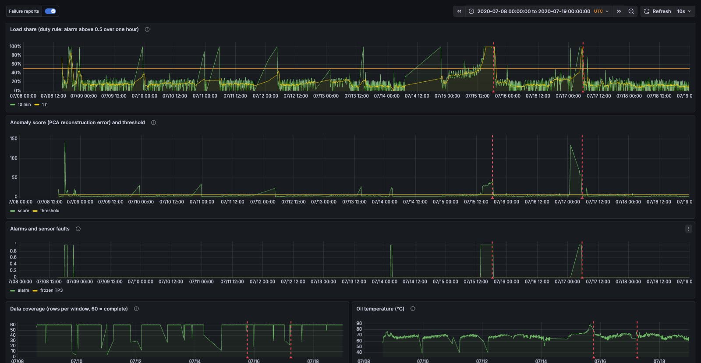
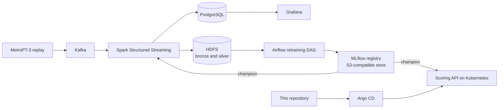
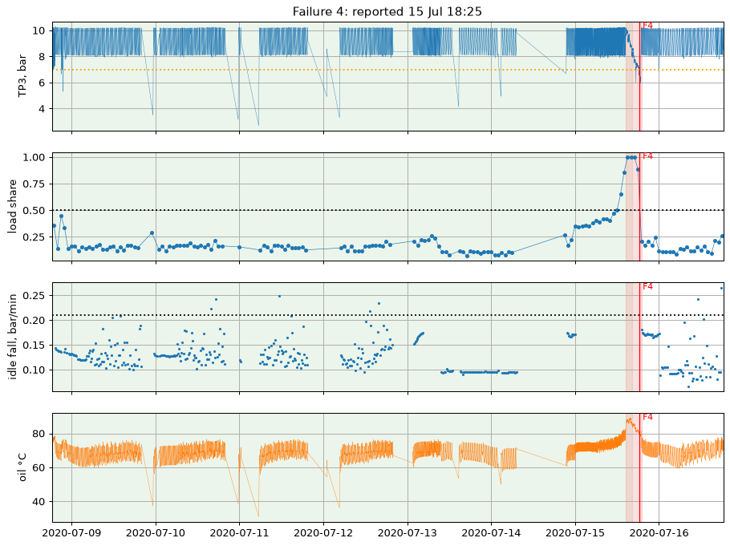
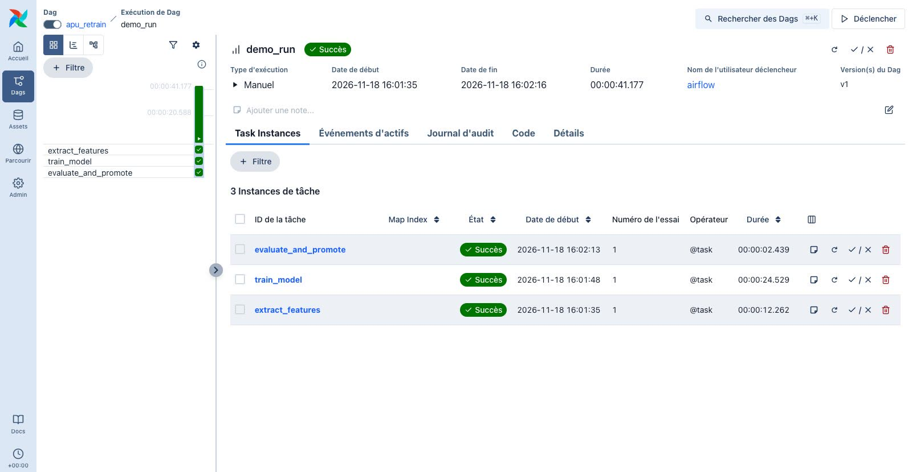
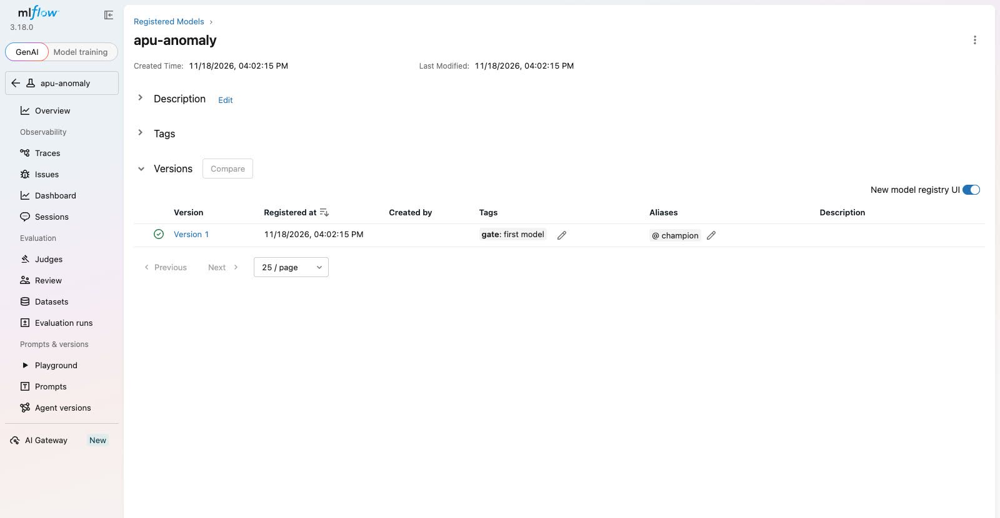

# apu-guard

[](https://github.com/abdelaalimouid/apu-guard/actions/workflows/ci.yml)

[](LICENSE)

Streaming failure detection for the air compressor of a metro train, built as a complete MLOps system on the open [MetroPT-3](https://archive.ics.uci.edu/dataset/791/metropt+3+dataset) dataset (Porto metro, 2020).

Sensor readings are replayed through Kafka and turned into 10-minute features by Spark Structured Streaming. An Airflow pipeline retrains an anomaly model, tracks it in MLflow and promotes it only if it passes a gate. The champion scores the stream live and serves an API on Kubernetes, deployed by Argo CD from this repository.



## Architecture



| Concern | Choice | Why |
|---|---|---|
| Ingestion | Kafka in KRaft mode, idempotent producer | Durable, replayable log that decouples the producer from Spark |
| Processing | Spark event-time windows, 2-minute watermark, HDFS checkpoints | Restart-safe and faithful to the time of each reading |
| Storage | HDFS Parquet for history, PostgreSQL upserts for serving | Large scans and fast dashboard queries have different needs |
| Model | StandardScaler + PCA reconstruction error (Spark ML) | Simple, explainable, and fitted on healthy months only |
| Lifecycle | Airflow DAG, MLflow `champion` alias, promotion gate | A worse model cannot reach production |
| Serving | FastAPI with numpy-only scoring | No Spark runtime needed in the serving image |
| Delivery | Kustomize and Argo CD | The cluster follows Git |

## Results

The model trains on 6,650 healthy windows from February and March 2020. It keeps 3 principal components (90.6% of the variance), and its alarm threshold is the 99.5th percentile of the training scores (7.04). Evaluation is event-level, from 1 April to 10 July 2020:

| Metric | PCA model | Duty-rule baseline |
|---|---:|---:|
| Failures warned | 3 of 3 | 3 of 3 |
| False alarm episodes | 12 | 11 |
| False alarms per 1000 recorded hours | 8.67 | 7.95 |

First sustained alarm in the 24 hours before each failure report:

| Failure | 1 | 2 | 3 | 4 (live) | 5 (live) |
|---|---:|---:|---:|---:|---:|
| Lead time | 6.4 h | 1.7 h | 7.8 h | 4.6 h | 1.1 h |

**How to read this.** The model does not beat the one-line duty rule: it warns the same failures with slightly more false alarms. The value of the project is the system around the model, and an honest evaluation that makes this visible. The leaks develop within hours, so earlier warnings would need physics-based features rather than a bigger model.



## Quickstart

Requirements: Docker Desktop with at least 8 GB of memory, [uv](https://docs.astral.sh/uv/), and minikube with kubectl for the Kubernetes part.

```bash
uv sync
bash scripts/get_data.sh                              # download MetroPT-3 (not stored in Git)
make up                                               # start the platform
make stream                                           # start the streaming job
make replay FROM=2020-02-01 TO=2020-07-10             # backfill five months
make stream-stop && make airflow && make train        # train, evaluate, promote and re-score
docker compose --profile airflow stop airflow         # free memory on 8 GB machines
make stream                                           # resume from the checkpoint
make replay FROM=2020-07-11 TO=2020-07-18 SPEED=2000  # replay failures 4 and 5 live
make results                                          # print the evaluation and first alarms
make k8s-up && make k8s-deploy && make k8s-test       # deploy the scoring API with Argo CD
```

To start again from empty storage, run `docker compose --profile airflow down -v` first. Otherwise Spark keeps its watermark and checkpoints.

| Interface | Address |
|---|---|
| Grafana | http://localhost:3000 |
| Spark master and running job | http://localhost:8080 and http://localhost:4040 |
| HDFS NameNode | http://localhost:9870 |
| MLflow | http://localhost:5050 |
| Airflow | http://localhost:8090 |

The credentials in `docker-compose.yml` are for this local demo only.

## Retraining and model registry

| Airflow retraining run | MLflow registry |
|---|---|
|  |  |

The first model becomes champion. A later model is promoted only if it warns at least as many failures with no more false alarms than the current champion on the same period. The stream picks up a new champion within a minute, without a restart.

## Development

```bash
make test    # unit tests
make lint    # Ruff checks and formatting check
make format  # apply Ruff fixes and formatting
uv run --group notebook jupyter lab notebooks/01_explore.ipynb
```

CI runs linting and tests, validates the Compose, Kustomize and shell files, and builds the scoring image on every push.

```text
src/apu_guard/
  config.py               settings shared by every component
  features.py             feature definition used by streaming and training
  scoring.py              numpy scoring and champion loading
  db.py                   idempotent PostgreSQL upserts
  producer/replay.py      MetroPT-3 to Kafka, in event time
  streaming/job.py        Kafka to HDFS, PostgreSQL and live scores
  training/               training pipeline and event-level metrics
  serving/app.py          FastAPI scoring service
dags/                     Airflow retraining DAG
infra/                    Dockerfiles, schema, dashboards, Kubernetes and Argo CD manifests
notebooks/                data exploration
tests/                    unit tests
```

[docs/WALKTHROUGH.md](docs/WALKTHROUGH.md) explains each component in detail.

## Limitations

- The data covers one compressor unit and five failure reports, so the results are a case study rather than a general performance estimate.
- The platform runs on one machine. HDFS, Kafka and Spark are configured for a demonstration, not for production availability.
- The Kubernetes staging deployment reaches MLflow on the host through minikube.

## Credits

- Data: Davari, Veloso, Ribeiro, Pereira and Gama (2021), MetroPT-3, UCI Machine Learning Repository, CC BY 4.0. The dataset is not redistributed here.
- Failure report times and evaluation protocol: Troshin, Komakhidze and Abakarov (2026), Zenodo, doi:10.5281/zenodo.23737435.
- Hadoop image: course material by Pr. Ziyati Houssaine (INPT).

The code is released under the [MIT License](LICENSE).
